# Campus Copilot: building AI agents with LangGraph

A practical lab that goes further than the brief. It covers every exercise of the **LangGraph lab** (state, nodes, edges, conditional routing, tools, memory, evaluation, capstone) in an executed notebook. Then it turns the capstone into a **multi-agent web product** that runs entirely on a local LLM:

- **LangGraph** multi-agent graph: a structured router, 5 specialists, a tool loop, retries;
- **MCP** (Model Context Protocol) tool server for campus data;
- **durable memory**: a SQLite checkpointer, conversations survive restarts;
- **live streaming** (FastAPI + SSE) with a run inspector: route, graph path, tool calls, timings;
- a minimalist UI with **hand-drawn architecture diagrams**, docs and evaluation pages;
- **local LLM**: `qwen3:8b` on Ollama, no API key, no data leaves the machine;
- **tests**: 11 pytest tests, plus a 16-case evaluation (100 % routing, tool choice and grounded answers).

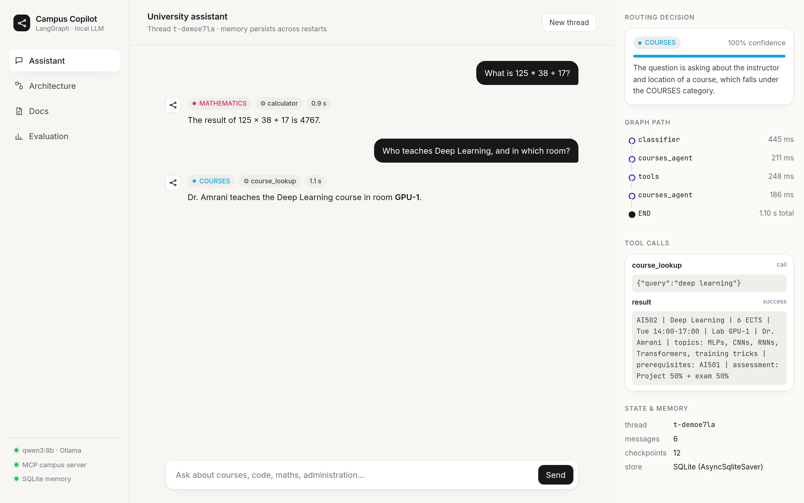

---

## Contents

1. [What's inside](#whats-inside)
2. [Screenshots](#screenshots)
3. [Architecture](#architecture)
4. [Technologies and tools](#technologies-and-tools)
5. [Run it](#run-it)
6. [Tests and evaluation](#tests-and-evaluation)
7. [Project structure](#project-structure)

The full walkthrough is in **[docs/ARCHITECTURE.md](docs/ARCHITECTURE.md)**.

---

## What's inside

| Deliverable | Where |
|---|---|
| Executed lab notebook (all parts, outputs, answers, extensions) | [`langgraph_lab.ipynb`](langgraph_lab.ipynb) |
| Report (conceptual questions + results) | [`report.pdf`](report.pdf) ([`report.md`](report.md)) |
| Capstone as a standalone script (lab version) | [`src/assistant.py`](src/assistant.py), [`src/tools.py`](src/tools.py) |
| **Web app** (going further) | [`app/`](app): `agent.py`, `server.py`, `mcp_server.py`, `evaluate.py`, `static/` |
| Architecture diagrams | [`diagrams/`](diagrams): hand-drawn (`hand_*.png`) + generated by LangGraph (`*.png`, `*.mmd`) |
| Screenshots | [`screenshots/ui/`](screenshots/ui) (web app) and [`screenshots/`](screenshots) (lab runs) |
| Tests | [`tests/`](tests), [`scripts/screenshots.py`](scripts/screenshots.py) (Playwright E2E) |

---

## Screenshots

**Home.** Suggested questions cover every agent.
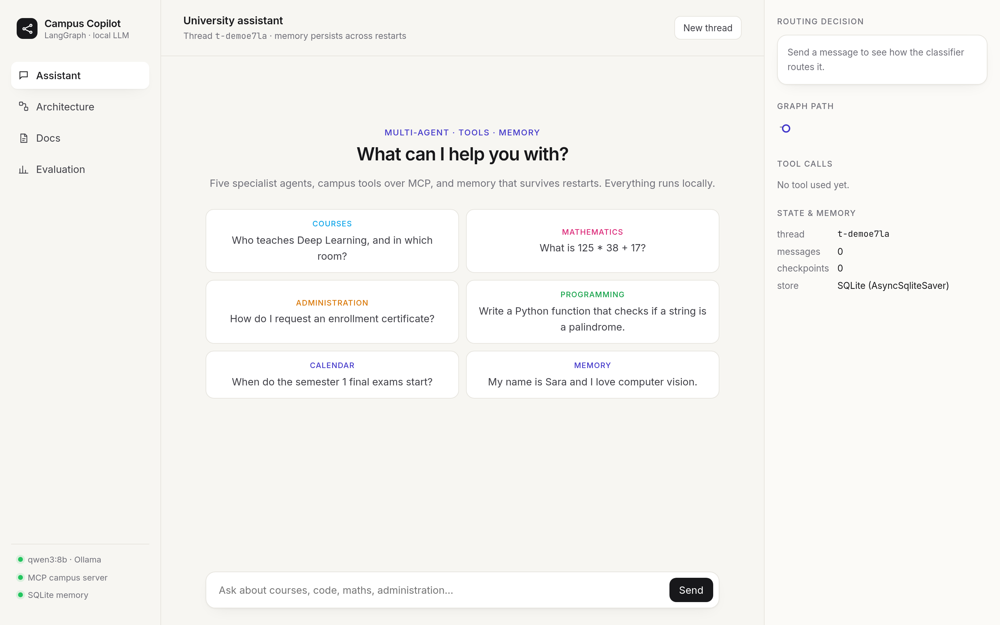

**Mathematics → calculator tool.** The inspector shows the routing decision (enum + confidence + reason), the graph path with per-node latency, and the tool call with its result.
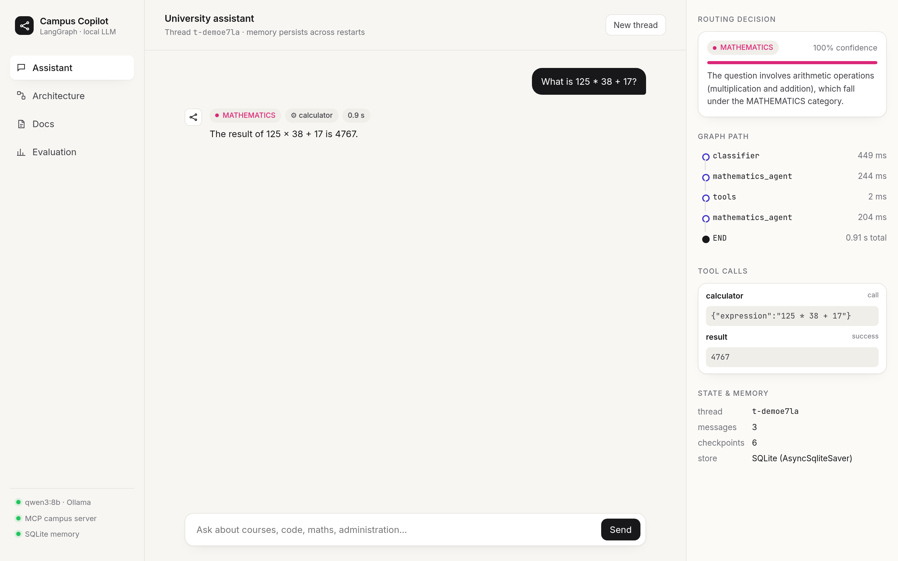

**Administration → `admin_procedure` (MCP).** The answer is grounded in official data, not invented.
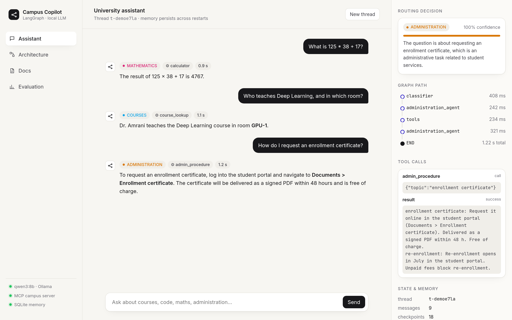

**Memory + context-aware routing.** The follow-up *"Which course fits that interest?"* is routed to COURSES using the previous turns, and is answered from the catalogue.
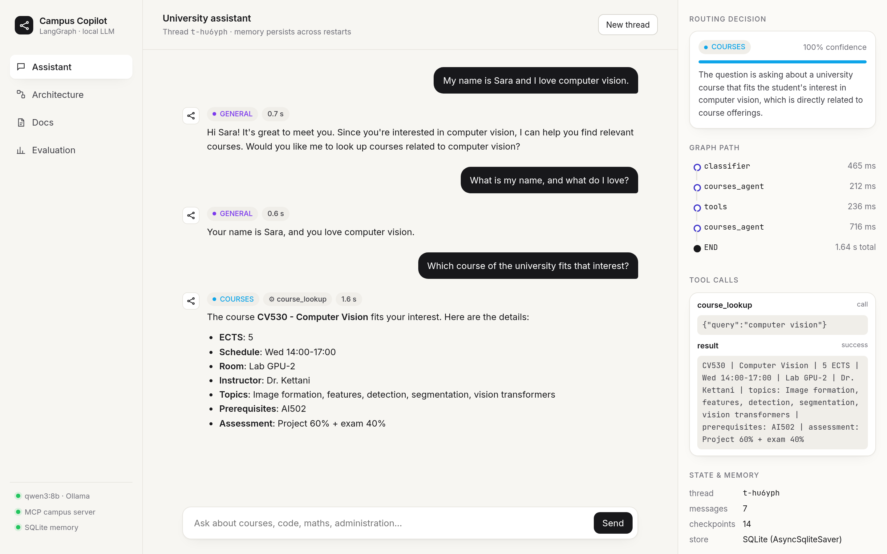

**Durable memory.** After a page reload, the thread is restored from the SQLite checkpointer.
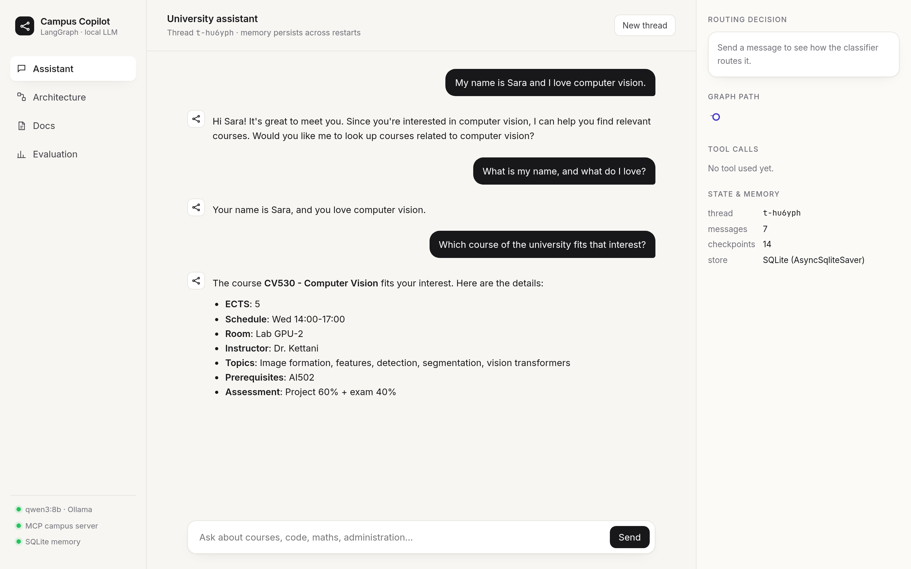

| Programming agent (no tools) | Empty input → fallback (no LLM call) |
|---|---|
| 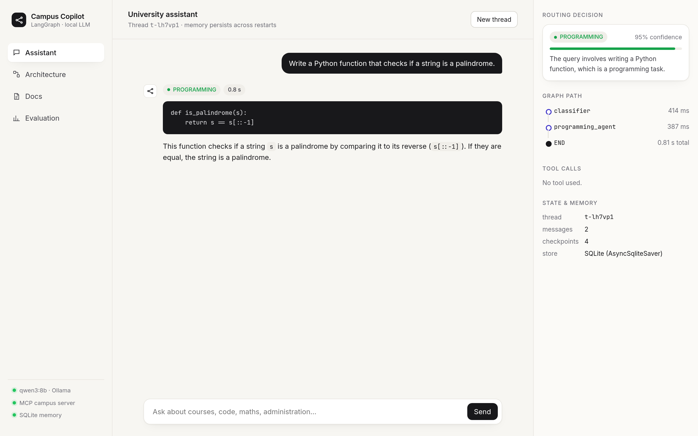 | 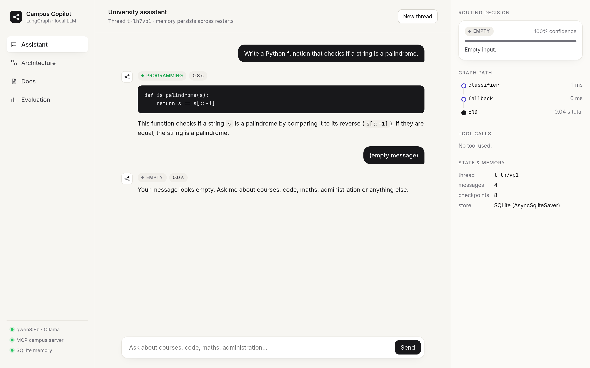 |

**Evaluation page.** 16 labelled questions; route, tool and answer are checked for each.
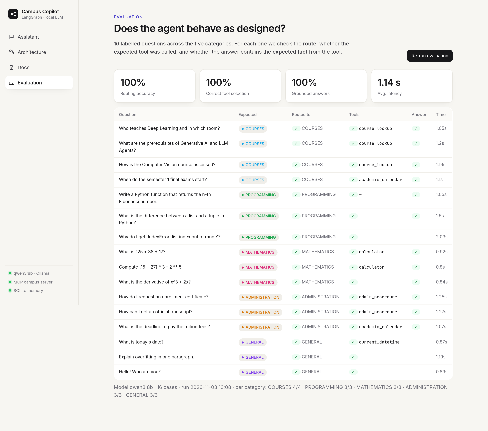

| `pytest -v`: 11 passed | `python -m app.evaluate` |
|---|---|
| 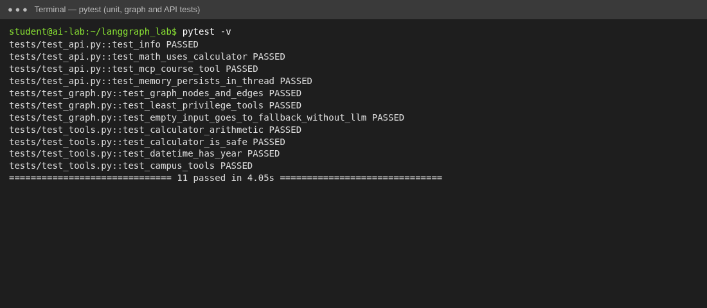 | 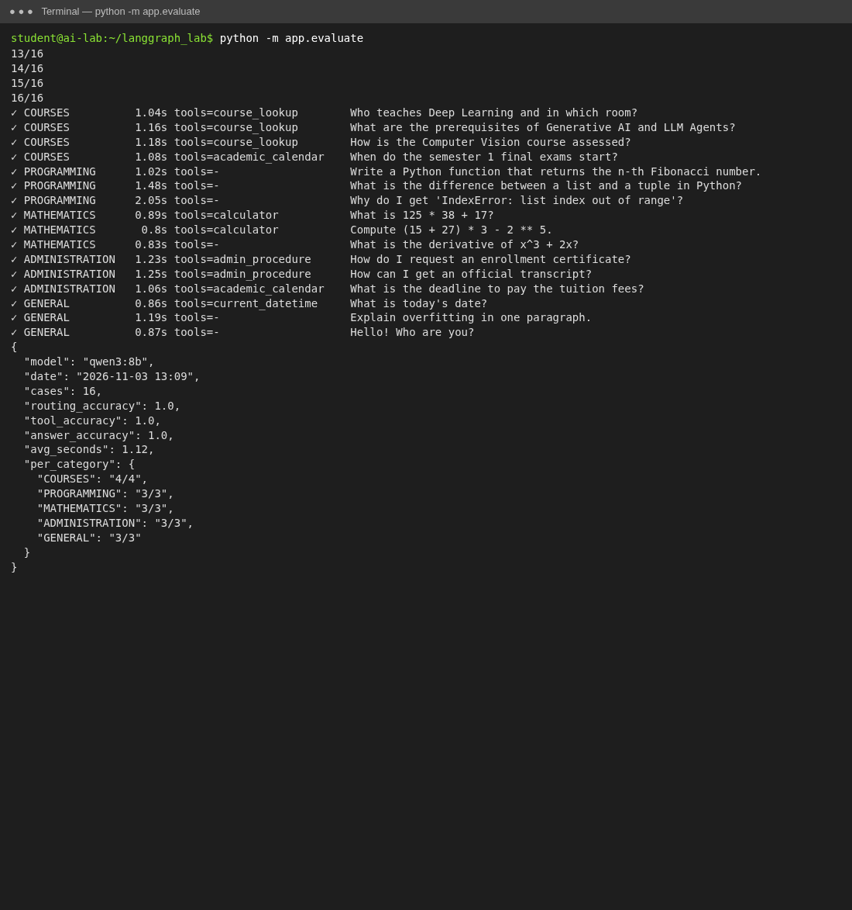 |

Full pages: [Architecture](screenshots/ui/09_architecture.png) · [Docs](screenshots/ui/10_docs.png)

---

## Architecture

### System
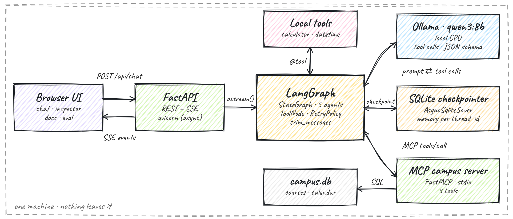

### Agent graph (LangGraph `StateGraph`)
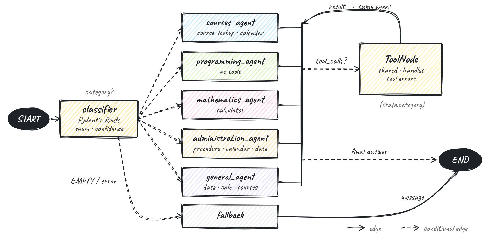

The classifier sends each message to one specialist through a **conditional edge**. A specialist that emits `tool_calls` goes to the shared `ToolNode`, and the result goes back to the **same** specialist (`state.category`), which then writes the final answer. An empty input goes to `fallback` without calling the LLM. The diagram LangGraph generates itself is in [`diagrams/assistant.png`](diagrams/assistant.png).

### Life of a request
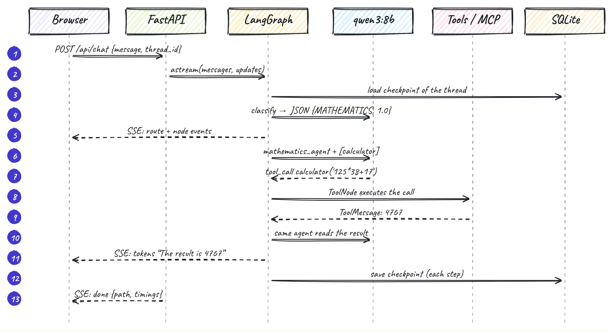

### Workflow in eight steps

1. **Receive.** `POST /api/chat` opens an SSE stream and calls `graph.astream(stream_mode=["messages","updates"])`.
2. **Restore.** The SQLite checkpointer loads the thread, and `add_messages` appends the new message.
3. **Classify.** A JSON-schema `Route` gives the category, a confidence and a reason. The prompt has few-shot examples and the last turns.
4. **Specialise.** A conditional edge picks one of 5 agents. Each has its own prompt and only its own tools; `trim_messages` bounds the context.
5. **Act.** `ToolNode` runs the local and MCP tools. Tool errors become `ToolMessage`s.
6. **Loop.** Control goes back to the same agent until it stops calling tools.
7. **Stream.** Tokens, node updates and tool events reach the browser live.
8. **Persist and recover.** A checkpoint is saved after every step. `RetryPolicy` retries failed LLM calls, and a final failure becomes a friendly message.

---

## Technologies and tools

| Technology | Role in this project |
|---|---|
| **LangGraph 1.2** | Orchestration: `StateGraph`, reducers, conditional edges, `ToolNode`, `RetryPolicy`, streaming, checkpointing |
| **LangChain Core 1.7** | Messages, `@tool`, `bind_tools`, `with_structured_output`, `trim_messages` |
| **Ollama + qwen3:8b** | Local LLM with tool calling and JSON-schema output; thinking mode off for latency |
| **langchain-ollama** | `ChatOllama`, which has the same interface as `ChatOpenAI` (one line to switch provider) |
| **Pydantic** | The `Route` schema (a `Literal` enum + confidence + reason) for reliable routing |
| **MCP**: `mcp` (FastMCP) + `langchain-mcp-adapters` | A separate campus tool server (stdio), with its tools discovered at start-up |
| **langgraph-checkpoint-sqlite** | `AsyncSqliteSaver`: persistent memory and time-travel history |
| **FastAPI + uvicorn** | Async API and Server-Sent Events streaming |
| **SQLite** | Campus data (courses, calendar) for grounded answers |
| **rough.js + Caveat font** | Hand-drawn SVG architecture diagrams, drawn in the browser |
| **marked** | Markdown rendering (raw HTML from the model is escaped) |
| **pytest + Playwright** | Unit, graph and API tests; headless-Chrome end-to-end run and screenshots |

### Agent tools

| Tool | Source | Used by | Description |
|---|---|---|---|
| `calculator` | local | MATHEMATICS, GENERAL | Safe AST arithmetic (no `eval`): `__import__('os')` → *Invalid expression* |
| `current_datetime` | local | ADMINISTRATION, GENERAL | Current date and time |
| `course_lookup` | MCP | COURSES, GENERAL | Course catalogue search (code, ECTS, schedule, room, instructor, prerequisites, assessment) |
| `academic_calendar` | MCP | COURSES, ADMINISTRATION | Semester, exam, break and fee dates |
| `admin_procedure` | MCP | ADMINISTRATION | Official procedures (certificates, transcripts, fees, …) |

---

## Run it

```bash
# 1. Local model
curl -fsSL https://ollama.com/install.sh | sh && ollama pull qwen3:8b

# 2. Environment
python3.11 -m venv .venv && source .venv/bin/activate
pip install -r requirements.txt

# 3. Web app
uvicorn app.server:app --port 8000            # → http://127.0.0.1:8000

# Lab notebook and scripts
python -m ipykernel install --user --name langgraph-lab
jupyter lab langgraph_lab.ipynb
python src/assistant.py            # capstone demo · --chat · --diagram

# Quality
pytest                             # 11 tests (Ollama must be running)
python -m app.evaluate             # → data/eval.json (shown in the Evaluation tab)
python scripts/screenshots.py http://127.0.0.1:8000   # Playwright E2E + screenshots
```

Use another model with `MODEL=llama3.2:3b uvicorn app.server:app`. The notebook switches to OpenAI if `PROVIDER=openai` and `OPENAI_API_KEY` are set; the key is never written in the code.

---

## Tests and evaluation

| Check | Result |
|---|---|
| `pytest`: tools, safety, graph structure, empty input without LLM, API streaming, MCP, memory and deletion | **11 / 11 passed** |
| Evaluation (16 cases): routing accuracy | **100 %** (per category 4/4, 3/3, 3/3, 3/3, 3/3) |
| Evaluation: correct tool selection | **100 %** |
| Evaluation: grounded answers (expected fact in the answer) | **100 %** |
| Average latency per question (local GPU) | **≈ 1.1 s** |
| Notebook: lab router on the 6 lab cases | 6/6; extended set: free-text 9/9 vs naive structured 7/9 (analysed in the notebook) |

---

## Project structure

```
langgraph_lab/
├── langgraph_lab.ipynb        # the lab, executed (Parts I–X + extensions)
├── report.pdf / report.md     # answers to the conceptual questions + results
├── src/                       # lab capstone as a script (MemorySaver, SQLite course tool)
├── app/
│   ├── agent.py               # Campus Copilot graph (router, specialists, tools, retries, trimming)
│   ├── mcp_server.py          # MCP campus server (FastMCP, stdio)
│   ├── campus_data.py         # fictional courses / calendar / procedures → SQLite
│   ├── server.py              # FastAPI + SSE streaming + threads + eval endpoints
│   ├── evaluate.py            # 16-case evaluation → data/eval.json
│   └── static/                # UI (HTML/CSS/JS, rough.js diagrams, vendored fonts)
├── tests/                     # pytest
├── scripts/screenshots.py     # Playwright end-to-end run
├── diagrams/                  # hand-drawn + LangGraph-generated diagrams
├── screenshots/               # lab runs + ui/
└── docs/ARCHITECTURE.md       # detailed architecture & workflow
```
