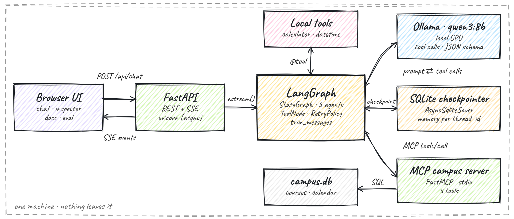
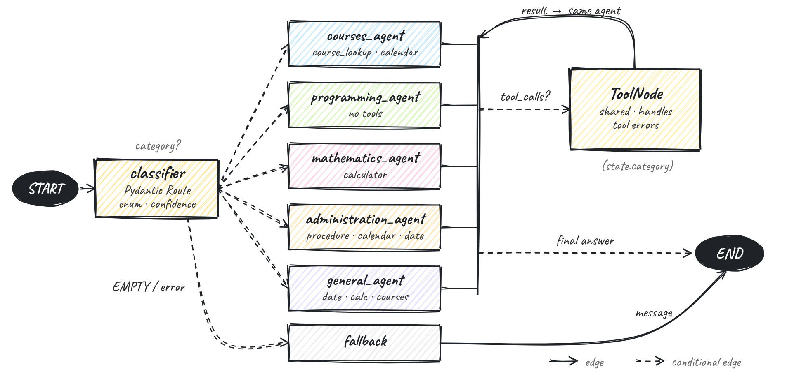
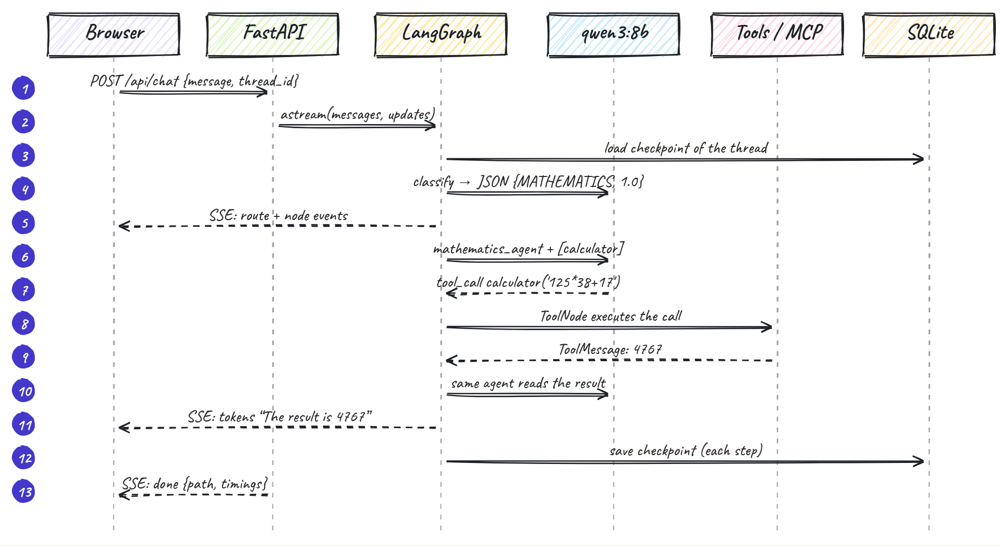

# Architecture & workflow, explained

This document explains how **Campus Copilot** works, from the browser down to the model, and why it is built this way. Read it with the three hand-drawn diagrams (they are also in the app's **Architecture** tab).

---

## 1. The big picture



Everything runs on **one machine**. No cloud API is called, and no key is needed.

| Layer | Component | Responsibility |
|---|---|---|
| Presentation | Browser UI (`app/static/`) | Chat, live run inspector, architecture, docs and evaluation pages |
| Serving | FastAPI (`app/server.py`) | REST endpoints, and **SSE streaming** of the graph run |
| Orchestration | LangGraph (`app/agent.py`) | The multi-agent `StateGraph`: classifier, 5 specialists, `ToolNode`, fallback |
| Intelligence | Ollama + `qwen3:8b` | Local LLM: routing (JSON schema), answers, tool-call decisions |
| Memory | `AsyncSqliteSaver` → `data/checkpoints.db` | One checkpoint per graph step and per `thread_id` |
| Tools | local `@tool`s + **MCP server** (`app/mcp_server.py`) | Calculator and date/time in-process; course catalogue, calendar and procedures over MCP |
| Data | `data/campus.db` (SQLite) | Fictional university data used by the MCP tools |

---

## 2. The agent graph



### State

```python
class State(TypedDict):
    messages: Annotated[list, add_messages]   # reducer: APPEND, never overwrite
    category: str                              # set by the classifier
    confidence: float
    reason: str
```

The state is the **only** thing nodes share. Each node returns a *partial update*, and LangGraph merges it. For `messages`, the `add_messages` reducer appends; the other keys are overwritten.

### Nodes

| Node | What it does |
|---|---|
| `classifier` | Empty input → `EMPTY` (no LLM call). Otherwise it calls the LLM with `with_structured_output(Route, method="json_schema")`. The JSON schema forces a valid enum label, a confidence and a reason. The prompt contains few-shot examples and the **last 4 turns**, so follow-ups such as *"which course fits that interest?"* are routed correctly. If the structured call fails, a free-text call is parsed instead. |
| `courses_agent` … `general_agent` | The same LLM with a different **system prompt**, bound to a different **subset of tools** (least privilege, see the table below). `trim_messages` sends only the last 16 messages, starting on a human turn. |
| `tools` | The prebuilt `ToolNode`, shared by every agent. It executes all tool calls of the last AI message. With `handle_tool_errors=True`, an unknown tool or bad arguments becomes an error `ToolMessage` instead of an exception. |
| `fallback` | A polite message for empty input or errors. |

| Agent | Tools it may call |
|---|---|
| COURSES | `course_lookup`, `academic_calendar` |
| PROGRAMMING | none |
| MATHEMATICS | `calculator` |
| ADMINISTRATION | `admin_procedure`, `academic_calendar`, `current_datetime` |
| GENERAL | `current_datetime`, `calculator`, `course_lookup` |

### Edges

- `START → classifier` is a normal edge.
- `classifier → {5 agents | fallback}` is a **conditional** edge: `after_classifier` reads `state.category`.
- `agent → {tools | END}` is conditional: `after_agent` checks whether the last message has `tool_calls`.
- `tools → agent` is conditional: `after_tools` goes back to the **same** agent (it reads `state.category`). That agent then sees the `ToolMessage` and either calls another tool or answers.
- `fallback → END` is a normal edge.

This is the classic **ReAct loop** (reason → act → observe → reason), but split across specialist agents.

### Reliability

- `RetryPolicy(max_attempts=3, initial_interval=0.5)` on the classifier and agent nodes retries transient failures (for example the model server restarting) with exponential back-off and jitter.
- If every attempt fails, the server catches the exception, sends an `error` SSE event and returns a friendly answer.

---

## 3. Life of one request



Example: **"What is 125 × 38 + 17?"**, with the real timings from the UI.

1. The browser sends `POST /api/chat {message, thread_id}` and reads the response as a stream.
2. FastAPI calls `graph.astream(input, config, stream_mode=["messages", "updates"])`.
   - `updates` gives one event per finished node.
   - `messages` gives the LLM tokens as they are generated.
3. The checkpointer loads the thread's last state, and `add_messages` appends the new question.
4. `classifier` (≈ 0.5 s) returns `{"category": "MATHEMATICS", "confidence": 1.0, "reason": "…arithmetic…"}`. The UI shows the route card.
5. `mathematics_agent` (≈ 0.2 s): the model, bound to `[calculator]`, returns a tool call `calculator({"expression": "125 * 38 + 17"})`.
6. `tools` (≈ 1 ms) runs the safe AST calculator and returns `ToolMessage("4767")`.
7. `mathematics_agent` runs again with the result. It streams *"The result of 125 × 38 + 17 is 4767."*
8. No more tool calls, so the graph goes to `END`. A checkpoint is written after every step (14 checkpoints for a 3-turn conversation).
9. FastAPI sends `done {answer, path, timings}`. The total is ≈ 0.9 s.

---

## 4. Memory, in three levels

| Level | Mechanism | Shown where |
|---|---|---|
| Within one run | `State.messages` (the tool loop sees its own results) | Graph path in the inspector |
| Across turns | Checkpointer + `thread_id` | Ask *"My name is Sara"* then *"What is my name?"* |
| Across restarts | **SQLite** checkpointer (not `MemorySaver`) | Reload the page or restart the server: the conversation comes back (`GET /api/threads/{id}`) |

Different `thread_id`s are fully isolated. `DELETE /api/threads/{id}` erases a conversation.

---

## 5. Why MCP for the campus tools?

**Model Context Protocol** is the open standard for connecting LLM apps to tools and data. The campus tools live in a **separate process** (`app/mcp_server.py`, FastMCP, stdio transport). At start-up the server runs `MultiServerMCPClient(...).get_tools()`, which launches it and converts each MCP tool into a LangChain tool.

The agent code does not change whether a tool is local or remote. The same campus server could also be used by a desktop assistant, an IDE or any other MCP client.

---

## 6. How this maps to the lab

| Lab part | Notebook (`langgraph_lab.ipynb`) | App (`app/`) |
|---|---|---|
| State, nodes, edges | Parts II–IV | `State`, `build_graph` |
| Conditional routing | Parts V–VI (free-text router) | Structured `Route` schema + few-shot + context |
| Tools | Parts VII–VIII (`calculator`, `current_datetime`) | + 3 MCP tools, least-privilege binding |
| Memory | Part IX (`MemorySaver`) | `AsyncSqliteSaver` (persistent) + `trim_messages` |
| Visualisation | `draw_mermaid_png` | Hand-drawn diagrams + live trace |
| Evaluation | Routing accuracy, 6 cases | 16 cases: route + tool + grounded answer + latency |
| Capstone | Part X (`src/assistant.py`) | Full web product with streaming |

---

## 7. Known limits

- An 8B local model sometimes *promises* to use a tool without calling it. Example: after *"My name is Sara and I love computer vision"* it offered to search the courses instead of searching. The system prompts reduce this, and the evaluation set measures it.
- The keyword search in `course_lookup` is simple SQL `LIKE`. A semantic search (embeddings) would handle synonyms.
- Each question costs ≥ 2 LLM calls (route + answer). A keyword pre-router could skip the LLM for obvious cases.
- The campus data is fictional demo data.
