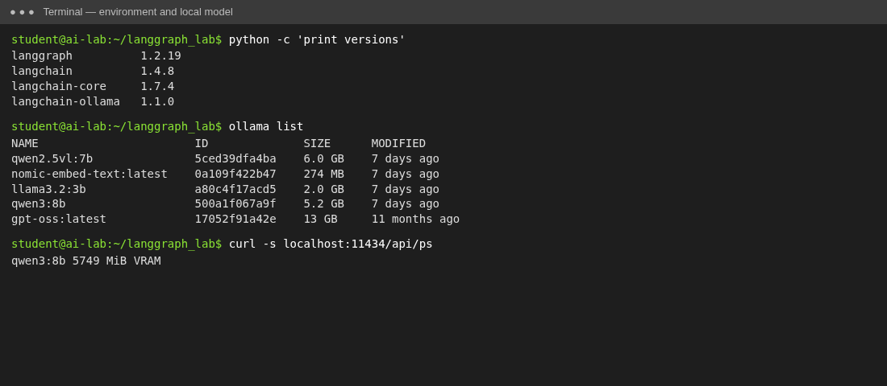
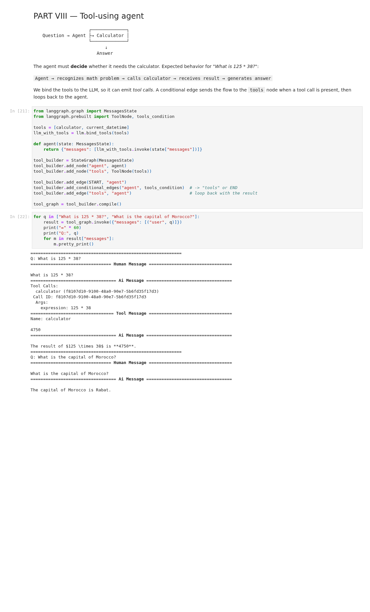
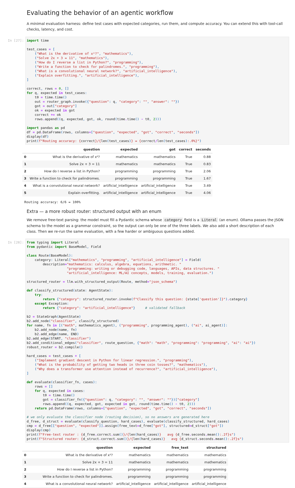
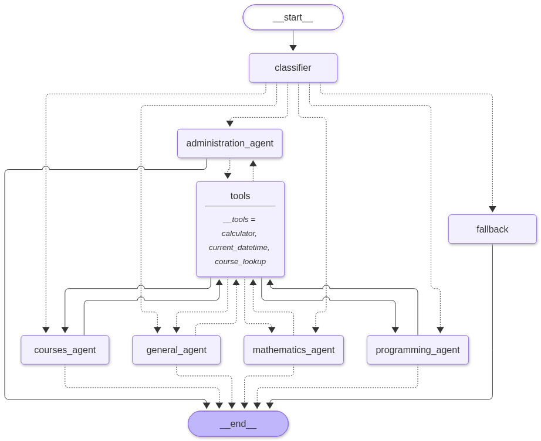
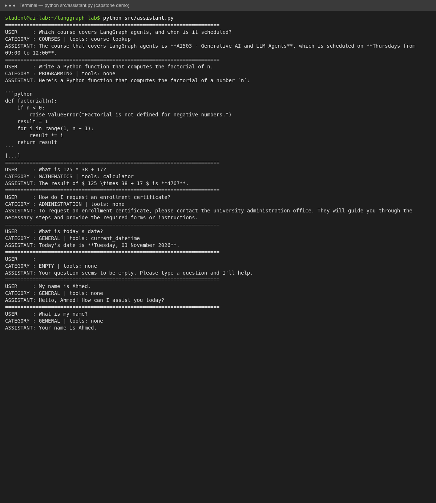
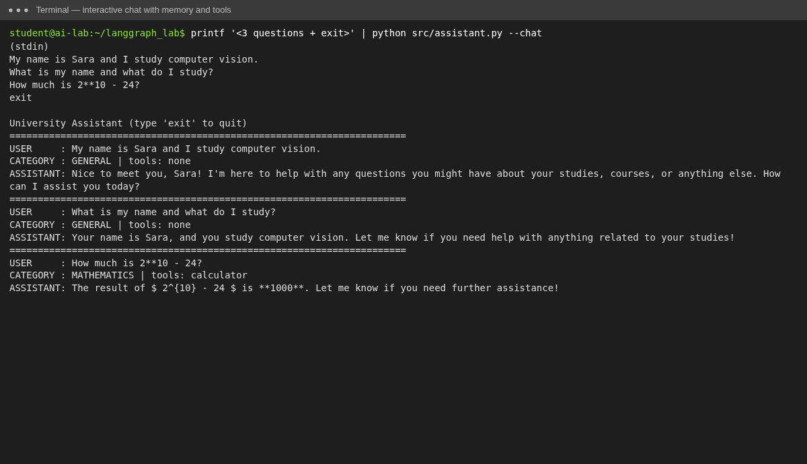

# 1. Setup

- **LLM:** `qwen3:8b` (Q4_K_M), served locally by Ollama on an NVIDIA GPU, through `langchain_ollama.ChatOllama`. Settings: `temperature=0`, `seed=42`, `reasoning=False`. There is no OpenAI key in this run. `ChatOllama` has the same interface as `ChatOpenAI`, so the lab code is unchanged. Setting `PROVIDER=openai` and `OPENAI_API_KEY` switches to `gpt-4o-mini`.
- **Versions:** langgraph 1.2.19, langchain 1.4.8, langchain-core 1.7.4, langchain-ollama 1.1.0, Python 3.11.
- Every cell of `langgraph_lab.ipynb` ran without errors. The same results came out on two runs in a row.

{width=80%}

# 2. Conceptual questions

## Exercise 1 — Roles of LangChain, LangGraph and the LLM

1. **LangChain** is the toolbox of building blocks for LLM applications. It gives one common interface to many models (`ChatOpenAI`, `ChatOllama`, ...), and it also provides messages, prompt templates, output parsers, retrievers and tools (`@tool`, `bind_tools`). With it you compose mostly *linear* pipelines (chains): prompt → model → parser.
2. **LangGraph** is built on LangChain. It is used for *stateful, multi-step, agentic* workflows. An application is a **graph**: a typed shared **state**, **nodes** (functions), and **edges**, including **conditional edges** and **cycles** (for example agent → tool → agent). It also adds checkpointing (memory per `thread_id`, resuming, human-in-the-loop) and streaming. LangChain says *how to call* a model or a tool; LangGraph says *what to do next* and *what to remember*.
3. **The LLM** is the reasoning and generation engine inside the nodes. It reads messages and returns either text or structured *tool calls*. It is stateless (each call only sees what is in its prompt), so memory, routing and tool execution are handled around it by LangGraph. Here it is `qwen3:8b`, run locally by Ollama.

## Exercise 2 — Nodes, edges, START, END, state

Result: `{'message': 'Hello LangGraph!', 'response': 'Agent received: Hello LangGraph!'}` (as expected).

1. A **node** is a unit of work: a Python function (or runnable) that receives the current state and returns a *partial update*, here `{"response": ...}`. Examples: a call to the LLM, a tool executor, a classifier.
2. An **edge** is a transition. It says which node runs after another one. A normal edge is fixed (`process → END`). A *conditional* edge chooses the next node at run time from the state.
3. **`START`** is the virtual entry point of the graph. The edge `START → process` says which node receives the input state first.
4. **`END`** is the virtual exit point. When the flow reaches `END`, execution stops and `invoke` returns the final state.
5. Nodes are independent functions that do not call each other. The **state** is their only shared memory and their contract. Each node reads what earlier nodes produced (for example `analysis` is used by `answer`) and returns only the keys it changes. LangGraph merges these updates (with reducers such as `add_messages`). Because the state is explicit, it can be checkpointed (memory), inspected, debugged and used for routing decisions.

# 3. Results of each part

| Part | What was observed |
|---|---|
| III–IV LLM node, two-stage agent | The analyzer → answer pipeline gives a structured explanation of reinforcement learning (agent, environment, reward, policy, algorithms). |
| V–VI Router | "derivative of x²" → mathematics (answer 2x), "REST API with Python" → programming (Flask code), "reinforcement learning" → artificial_intelligence. |
| VII Tools | `calculator("25 * 4 + 10")` = 110. The safe version rejects `__import__('os')`. `current_datetime` works. |
| VIII Tool agent | "125 * 38": AIMessage with a tool call → ToolMessage `4750` → final answer. "Capital of Morocco": no tool, "Rabat". |
| IX Memory | Without a checkpointer the agent does not know the name. With `MemorySaver` + `thread_id` it answers "Your name is Ahmed". A different `thread_id` does not know it. |
| Evaluation | Routing accuracy 6/6 = 100 %. Extended set (9 questions): free-text 9/9, structured/enum 7/9. |
| X Capstone | All 5 categories routed correctly. `calculator` (125·38+17 = 4767), `current_datetime` (today's date) and `course_lookup` (AI503 on Thursdays 09:00–12:00) were called when needed. The empty question goes to the fallback. Memory works per thread. Invalid tool calls give error ToolMessages, not crashes. |

{width=85%}

# 4. Evaluation discussion — where did the router fail?

On the 6 lab test cases the free-text router (`qwen3:8b`, temperature 0) made **no mistake: 6/6 = 100%**. It also got 9/9 on the extended set below, which adds harder questions that mix fields, such as *"Implement gradient descent in Python"*, where maths/ML vocabulary appears in a programming request. With such a small test set this does not prove the router is robust. The weak points are in the design:

- **Fragile parsing.** The label is free text, and we only check `"mathematics" in category`. If the model answers *"Category: Math"*, adds an explanation, or writes *"AI"*, the substring test fails. The router then silently falls back to `ai`, because `route_question` sends everything unknown there. A wrong route raises no error, so it can go unnoticed.
- **Ambiguous classes.** "Gradient descent in Python" or "probability of a neural network output" fit two classes. The prompt does not say which one wins.

Ways to make it more robust:
1. **Structured output + enum validation.** `with_structured_output` with a `Literal[...]` field makes the label always valid, so no parsing is needed. *Our test (extra cell below) shows the limit of this:* the structured router produced only valid labels, but it scored **7/9**. It sent *"Explain overfitting"* and *"Why does a transformer use attention…"* to `programming`, probably because of the wording of our field description ("models, training" under AI, "data structures" under programming). A valid format does not guarantee a correct label.
2. **Few-shot examples** in the prompt, especially for borderline cases, and an explicit tie-break rule (for example "if the user asks for code, choose programming").
3. **Validation + fallback + logging.** Map synonyms (`math` → `mathematics`), use a low-confidence/"other" class that asks the user to clarify, and log misroutes.
4. **A bigger, labelled evaluation set** (tens of questions per class, including adversarial ones), re-run after every prompt or model change. We could also add a confidence score or ask the model twice and vote (self-consistency).

{width=85%}

# 5. Capstone — Intelligent University Assistant

**Architecture.** A `classifier` sends the question to one of five agents (COURSES, PROGRAMMING, MATHEMATICS, ADMINISTRATION, GENERAL), or to a `fallback` node for an empty question or an error. Each agent is the same LLM with a different system prompt and the tools bound to it. If the agent emits a tool call, `route_after_agent` goes to the shared `tools` node. Then `route_after_tools` goes back to the **same** agent (read from `state["category"]`), which writes the final answer. A `MemorySaver` checkpointer keeps the message history per `thread_id`.

{width=75%}

**Requirements.**

1. Classifier: `classify`, with 5 categories and validation of the label.
2. Specialized agents: `make_agent` factory, one system prompt per category.
3. Memory: `MemorySaver` + `thread_id`.
4. Tools: safe `calculator`, `current_datetime`, and the extension `course_lookup` (SQLite course catalogue).
5. Conditional routing: three routing functions.
6. Error handling:
   - an empty input goes to `fallback`;
   - an unknown label becomes GENERAL;
   - an API error goes to `fallback`, or a polite message from the agent;
   - an invalid tool call is caught by `handle_tool_errors=True`;
   - an invalid expression makes the calculator return "Invalid expression".

**Limits observed.**

- For the ADMINISTRATION questions the agent correctly refuses to invent rules. Without an institutional data source, though, it can only send the user to the office.
- The free-text classifier works with qwen3:8b but depends on the model following the instructions; this is discussed in §4.
- Each question costs two LLM calls (classification + answer), and three if a tool is used.

{width=85%}

{width=85%}
